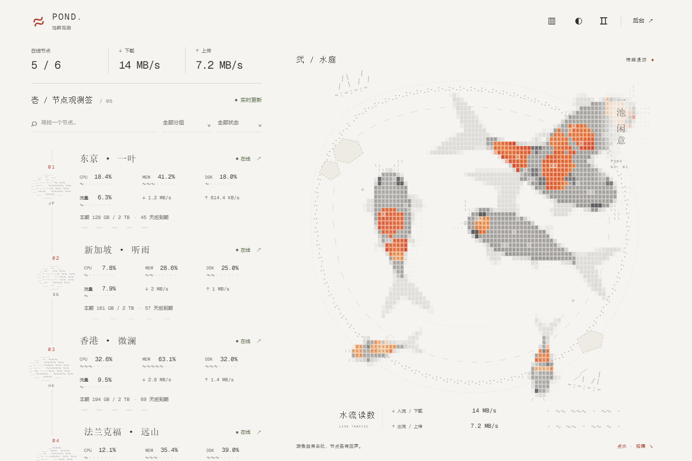
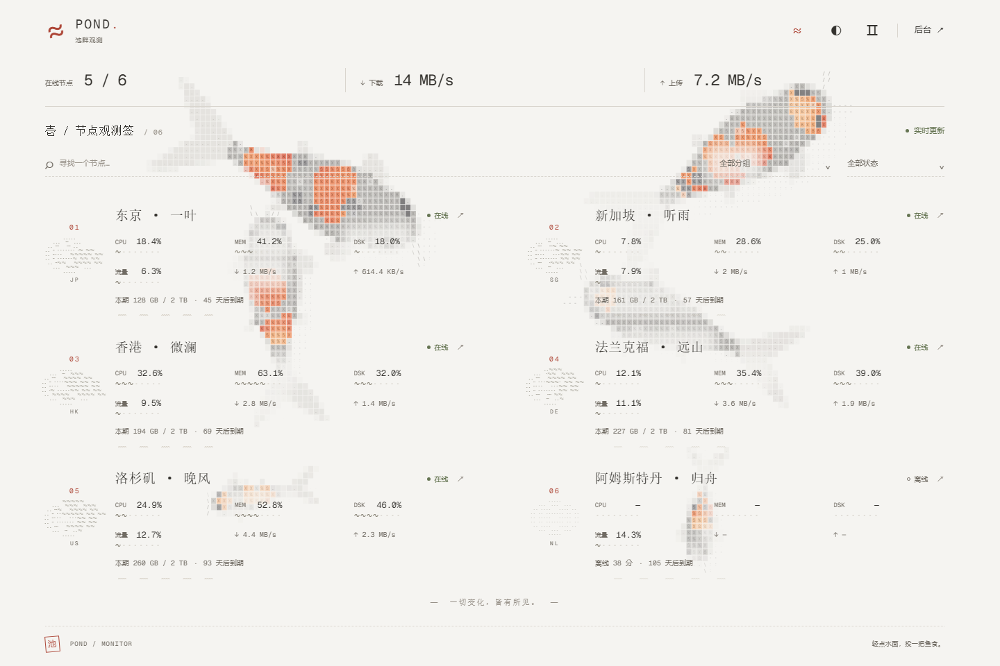
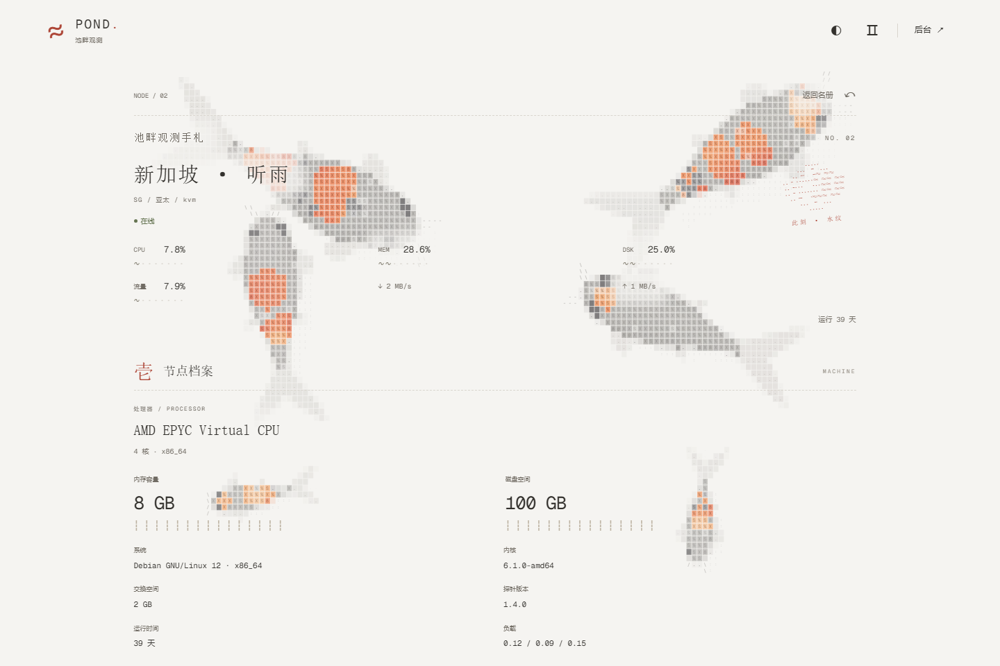
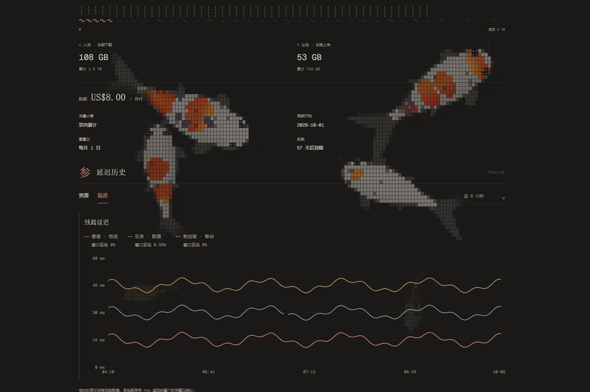
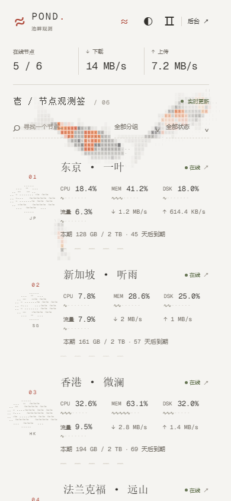
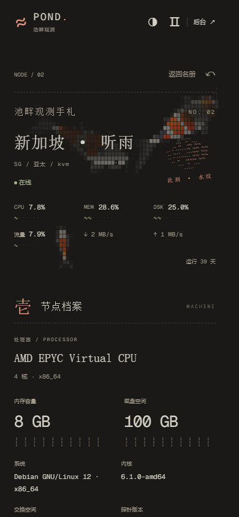

# 锦鲤池塘 · Pond

**水静，鱼游。**

在一方字符池塘里，照看远方的节点。

**Pond** 是一款适用于 [Monitor](https://github.com/monitor-probe/monitor) 的锦鲤池塘主题。字符锦鲤穿过水纹，实时读数落在纸面上；纸白与暖黑之间，以一圈涟漪切换日夜。

节点以文字、波纹刻度与水纹印记呈现。你可以查看服务器状态，也可以停下来，往水面投一把鱼食。

## 两种显示方式

同一方池塘，两种观看方式。点击页头配色按钮左侧的 **▥ / ≈** 图标即可切换，选择会自动记住。

<table>
  <tr>
    <th width="50%">▥ 水庭模式</th>
    <th width="50%">≈ 游鱼背景模式</th>
  </tr>
  <tr>
    <td></td>
    <td></td>
  </tr>
  <tr>
    <td>名册与水庭相伴。桌面右侧池塘固定，滚动节点时仍能看见游鱼；窄窗口和手机将水庭放在名册上方。</td>
    <td>整个窗口都是水面。节点名册铺开，锦鲤在文字之间游动；无论全屏、缩小窗口还是滚动页面，背景始终覆盖可见区域。</td>
  </tr>
</table>

## 看鱼，也看节点

- **实时状态**：CPU、内存、磁盘与上下行速率一目了然，在线、离线、等待上报和异常状态各有标识。
- **流量与账期**：字符波纹呈现本期流量占比，同时展示用量、额度和到期信息。
- **搜索与筛选**：按名称、分组、在线状态查找节点，汇总数字随筛选结果变化。
- **资源与延迟**：查看资源历史与网络平均值、峰值；各探测线路的延迟汇聚在同一张图里，保留各自的名称、断点与窗口丢包率。

鱼群独立于节点存在。节点刷新、搜索或切换页面时，游动不会因此重新开始。

## 一页观测手札

点击节点，展开它的观测记录：硬件、系统、运行时间、公开备注、流量、费用与历史曲线，都沿纸面排开。锦鲤仍在整个窗口中游动，正文附近的鱼影会减淡，让读数保持清楚。

详情页可以直接分享链接；返回名册后，原来的显示方式、筛选条件与阅读位置都会保留。

<table>
  <tr>
    <th width="50%">节点档案 · 纸白</th>
    <th width="50%">线路延迟 · 暖黑</th>
  </tr>
  <tr>
    <td></td>
    <td></td>
  </tr>
</table>

## 小屏幕，也有一池闲意

手机上，节点名册自然排列为单列，两种显示方式都可使用。纸白适合日间，暖黑适合夜晚；也可以跟随系统配色。

  
  &nbsp;
  

*以上预览中的节点与数值均为演示数据。*

## 使用

| 操作 | 效果 |
| --- | --- |
| 点击 **▥ / ≈** | 切换水庭与游鱼背景模式 |
| 点击 **◐ / ◑** | 切换纸白与暖黑配色 |
| 点击 **Ⅱ / ▷** | 暂停或继续游鱼 |
| 在空白水面轻点 | 投喂鱼食，泛起水波 |
| 移动鼠标 | 吸引锦鲤靠近 |
| 点击节点 | 打开观测手札 |
| 点击 **后台 ↗** | 进入 Monitor 管理后台 |

显示方式、配色与暂停偏好会在当前浏览器中保存。暂停时不能投喂，配色会直接切换；系统启用“减少动态效果”时，池塘以静态画面呈现。

## 安装

适用于 **Monitor 的自定义主题功能**，需要已有的 Monitor 站点。

1. 从 [Releases](https://github.com/ayingQAQ/monitor-ascii-pond/releases/latest) 下载主题安装包 `theme.tar.gz`，无需解压。
2. 进入 Monitor 后台，在主题管理中上传安装包。
3. 选择并启用 **锦鲤池塘 · Pond**，按需调整主题设置。

### 主题设置

| 设置 | 默认值 | 说明 |
| --- | --- | --- |
| 公告 | 空 | 在首页展示一段站点公告 |
| 首页小标题 | 空 | 主标题上方的文字，留空隐藏 |
| 首页标题 | 空 | 首页主标题，留空隐藏 |
| 首页副标题 | 空 | 主标题下方的文字，留空隐藏 |
| 默认背景色 | 跟随系统 | 可选纸白（浅色）、暖黑（深色）或跟随系统 |
| 默认显示模式 | 水庭模式 | 可选水庭模式或游鱼背景模式 |
| 显示锦鲤池塘 | 开启 | 控制是否显示游鱼 |
| 允许投喂 | 开启 | 控制水面投喂交互 |
| 显示到期信息 | 开启 | 控制节点到期信息的展示 |

后台设置决定访客首次打开页面时的背景色与显示模式。访客手动切换过后，优先使用当前浏览器保存的个人选择。

首页默认直接呈现实时汇总、节点名册与池塘。需要标题文案时，可在主题设置中填写；已有的自定义文案会保留，将三项清空即可使用紧凑布局。

## 开源许可

本项目采用 [MIT License](LICENSE)，欢迎使用、修改和分享。再分发时，请保留相应的版权与许可声明。

Geist Mono 字体采用 [SIL Open Font License](licenses/GEIST-OFL.txt)；monitor-mc 的许可见 [MIT 声明](licenses/MONITOR-MC.txt)，其他开源组件见 [第三方许可](THIRD_PARTY_NOTICES.txt)。

## 原项目

本主题的字符锦鲤、游动、水波与投喂效果源自 **[stqfdyr/ascii-pond](https://github.com/stqfdyr/ascii-pond)**。

Pond 在此基础上融入 Monitor 的节点观测界面，保留了原项目的字符水面与安静氛围。原项目采用 MIT 许可证，相关版权与许可声明保留于 [ASCII-POND.txt](licenses/ASCII-POND.txt)。
